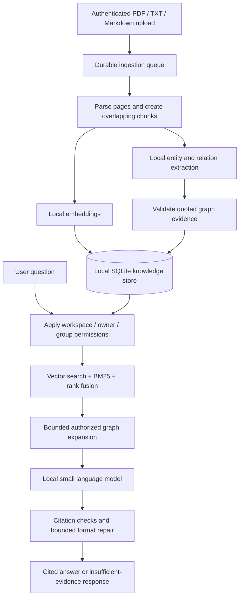

# ResearchGraphAI

### Your documents. Your machine. Evidence-backed answers.

ResearchGraphAI is a local-first knowledge assistant for organizations that want to ask questions
about private documents without sending their contents to an external LLM API. It combines a small
locally hosted language model, hybrid search, and an evidence-backed entity graph in one application.

**Upload documents → build a searchable knowledge graph → ask questions → inspect cited sources.**

The project is a single-machine MVP built around pretrained models, not a foundation model trained
from scratch. Its value is the private document pipeline, permission-aware retrieval, traceable
answers, and optional local adaptation—not a claim that its base model outperforms larger models.

[Architecture](docs/ARCHITECTURE.md) · [Deployment](docs/DEPLOYMENT.md) ·
[Training](docs/TRAINING.md) · [Security](docs/SECURITY.md) ·
[Evaluation](docs/EVALUATION.md) · [Interview guide](docs/INTERVIEW.md)

## Why this project?

A small model alone does not know a company's current documents, enforce document permissions, or
show where an answer came from. ResearchGraphAI adds those capabilities around a local model.

- **Keep inference local:** Qwen3 1.7B and `nomic-embed-text` run through Ollama; no external LLM API key is required.
- **Update knowledge without retraining:** new documents update the retrieval index and graph. Fine-tuning is optional and intended for behavior or domain tasks.
- **Find connected evidence:** combine semantic search, BM25 keyword search, and bounded entity-graph traversal.
- **Inspect the answer:** citations link back to source passages, with document versions and PDF page provenance.
- **Respect access boundaries:** workspace, owner, and group permissions filter candidates before ranking and graph expansion.
- **Deploy on your own hardware:** native Windows setup, Docker Compose, optional GPU configuration, and offline bundle tooling.

Running locally avoids per-request hosted-model charges, but still has hardware, electricity,
maintenance, and setup costs. Whether it is cheaper depends on workload and existing infrastructure.

## How it works



This is **local entity-graph RAG**, not Microsoft's community-summary/global GraphRAG implementation.
Graph edges retain source evidence, but provenance checks and valid citations do not prove that
every relationship or answer is correct. See the [full pipeline](docs/ARCHITECTURE.md) for the
retrieval formula, permission boundaries, citation handling, and scaling tradeoffs.

## Features

| Area | Implemented capabilities |
| --- | --- |
| Documents | Text-based PDF, TXT and Markdown; 25 MB upload limit; durable jobs; deduplication and document versions |
| Retrieval | FAISS exact search with NumPy fallback, local BM25, weighted reciprocal rank fusion |
| Knowledge graph | Company-scoped entities, typed relations with quoted evidence, bounded traversal up to three hops |
| Answers | Local generation, source inspection, citation validation and insufficient-evidence responses |
| Access | Hashed bearer credentials, workspace/owner/group authorization, credential revocation |
| Adaptation | Optional local LoRA/QLoRA, dataset checks, held-out evaluation, explicit adapter approval |
| Interface | React workspace for uploads, ingestion status, answers, source evidence, connections and training-run metrics |
| Operations | Native launcher, Docker Compose, GPU override, private runtime network and offline bundle scripts |

## Technology stack

| Layer | Technology |
| --- | --- |
| Web interface | React 19, TypeScript, Vite 8 |
| API and jobs | Python, FastAPI, one durable ingestion worker |
| Storage and search | SQLite, FAISS / NumPy, BM25 |
| Local models | Ollama, Qwen3 1.7B, `nomic-embed-text` |
| Optional adapter training | Hugging Face Transformers, PEFT, LoRA / QLoRA |
| Deployment and checks | Docker Compose, pytest, Ruff, GitHub Actions |

## Quick start

Clone the repository first:

```sh
git clone https://github.com/Shivansh-58/ResearchGraphAI.git
cd ResearchGraphAI
```

Initial setup needs internet to download dependencies and public model weights. Keep private
documents out of the connected setup phase. Model weights, credentials, company documents,
databases, and training outputs are deliberately **not included** in this repository.

### Option A: Windows, without Docker

Prerequisites: **Python 3.12**, **uv**, and **Node.js 24** available in your terminal.
From the repository root, run:

```powershell
.\scripts\start-native.ps1 -Prepare
```

The preparation step installs dependencies, builds the interface, and prepares the local model
runtime and weights. Open **http://127.0.0.1:8000** once startup completes. The launcher remains
running in the terminal; stop it with Ctrl+C.

For later starts:

```powershell
.\scripts\start-native.ps1
```

Native mode binds to loopback, but does not enforce operating-system-level network isolation.

### Option B: Docker Compose

Prerequisites: **Docker Desktop / Docker Engine with Compose**, a running Docker engine, and
**Python 3.12** (`python` on Windows or `python3` on Linux).

Windows, CPU configuration:

```powershell
.\scripts\install.ps1
```

For a supported NVIDIA GPU and configured container GPU runtime, use
`.\scripts\install.ps1 -Gpu` instead. On Linux, the CPU installer is:

```sh
sh scripts/install.sh
```

Open **http://localhost:8080**. Setup downloads public weights, then recreates the runtime on an
internal Compose network. Only the web entry point is bound to the host loopback interface.
Read the [deployment guide](docs/DEPLOYMENT.md) before using offline bundles or adapter serving.

**Verification boundary:** native inference and the local test suite have been exercised. Compose
configurations have been validated, but a complete Docker runtime deployment has not yet been
verified on the development machine. Do not treat configuration validation as a deployment test.

### Try your first question

1. Open `secrets/admin.token` **locally** and paste the generated token into the sign-in form. Never commit or share this file.
2. Upload a text-based PDF, UTF-8 TXT, or Markdown document.
3. Wait for the ingestion job to become ready.
4. Ask a question supported by the document.
5. Open a citation to inspect the passage; use the connections tab to explore extracted relations.

Scanned PDFs need OCR before upload; encrypted PDFs must be unlocked. No external OCR service is
silently called. For a safe demo, use synthetic documents rather than real company material.

## Optional local training

Document updates normally require **ingestion, not fine-tuning**. When you need to adapt answer
behavior or a domain task, the separate training pipeline supports:

1. Validating labeled train/validation/test examples and checking for leakage.
2. Training a small LoRA/QLoRA adapter while keeping the base model frozen.
3. Comparing the base model and adapter on held-out examples.
4. Explicitly approving an adapter before same-company serving.

Training is not triggered automatically by document upload. Hardware requirements depend on the
base model, sequence length, and quantization settings. Follow the [training guide](docs/TRAINING.md)
for commands, prerequisites, evaluation, and serving restrictions.

## Project structure

```text
ResearchGraphAI/
├── backend/
│   ├── app/
│   │   ├── api/               # HTTP routes and request schemas
│   │   ├── core/              # Configuration, authentication, logging
│   │   ├── domain/            # Data objects and interfaces
│   │   ├── infrastructure/    # Storage, parsers, search and local models
│   │   └── services/          # Ingestion and retrieval/graph/synthesis stages
│   └── tests/                 # Pipeline, privacy and regression tests
├── frontend/                  # React interface
├── deploy/                    # Dockerfiles, Compose variants and reverse proxy
├── scripts/                   # Setup, bootstrap, verification and offline tools
├── training/                  # Dataset validation, adapter training and evaluation
├── evaluation/                # Synthetic retrieval evaluation fixture
├── docs/                      # Architecture, deployment, security and interview guides
└── .github/workflows/         # Automated validation
```

Local-only directories such as `data/`, `models/`, `secrets/`, and `.runtime/` are ignored by Git.
See [architecture](docs/ARCHITECTURE.md) for file responsibilities and persistence details.

## Development and validation

Install backend dependencies and run checks from the repository root:

```sh
uv sync --project backend --extra dev --extra faiss
uv run --project backend ruff check backend/app backend/tests scripts training --config backend/pyproject.toml
cd backend
uv run pytest
cd ../frontend
npm ci
npm run build
cd ..
```

With the native application running, exercise the real local-model pipeline:

```sh
uv run --project backend python scripts/verify_local.py --url http://127.0.0.1:8000
```

The smoke test uploads a synthetic document, checks authentication and a cited answer, then removes
the test document. GitHub Actions is configured to run lint, backend tests, the frontend build,
Compose checks, image builds, and a tiny adapter-training smoke test. A separate full container
smoke job is available through manual workflow dispatch.

### Recorded local results

- **67 backend tests passed; 91% statement coverage** in the recorded local run.
- Frontend production build, lint, native model-backed smoke test, and Compose configuration checks passed.
- A tiny CPU LoRA fixture completed training, save/reload, and evaluation; this validates the workflow, not useful model quality.
- The small synthetic graph ablation did **not** establish an accuracy advantage over ordinary hybrid RAG.

These are recorded development results, not guarantees for a new machine or dataset. The
[evaluation report](docs/EVALUATION.md) documents the scope, metrics, and untested paths.

## Security and current limits

- Intended for one local machine/server and modest document collections; not a multi-node enterprise platform.
- One API process and one ingestion worker; exact per-principal indexes have memory and scaling limits.
- No enterprise SSO, at-rest encryption, compliance certification, or production security audit is claimed.
- Citation formatting checks and graph provenance do not eliminate hallucinations or prompt injection.
- Alias resolution can miss cross-document synonyms; more graph hops are not automatically better.
- Meaningful company-adapter quality, GPU QLoRA, and fully disconnected operation need separate validation.
- Public model weights and dependencies have their own licenses; review them before commercial deployment.

Read [SECURITY.md](docs/SECURITY.md) before using sensitive documents. Never post credentials,
company files, private training examples, or unredacted logs in public issues.
